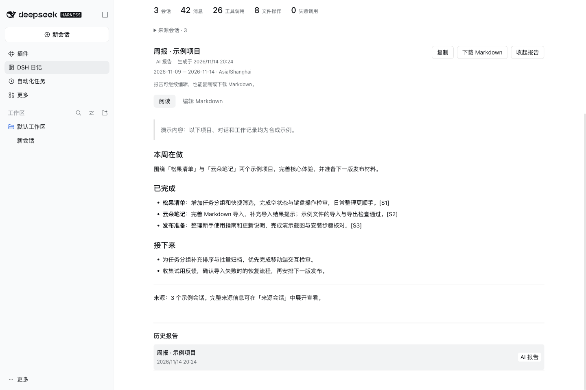

# DSH 日记 · DSH Journal

将 DeepSeek Harness 的会话和已记录文件操作，整理成简洁的中文日报、周报、月报或自定范围工作报告。

## 能做什么

- 按日、周、月或自定起止日期整理，支持 IANA 时区，包含开始和结束当天。
- 读取所选期间内的消息和工具执行记录，也能找到较早创建、本期仍有活动的会话。
- AI 报告聚焦 **做了什么、已完成、待办**；保留来源，区分计划、失败与实际完成。
- 使用 DSH 已配置的模型，可为简报单独选择模型；支持时自动使用关闭思考或较轻推理档。
- 根据模型上下文容量安排完整输入，容量不足时再分批，最多并发两批。
- 本地整理不调用模型；报告可编辑、保存、复制和下载为 Markdown。



截图使用合成示例数据，不含真实会话。

## 安装

已验证 **DeepSeek Harness 0.2.2-rc.3**（macOS Desktop 与隔离 Web），运行时要求 Node 24.9 及以上。接口处于预览阶段，其他 DSH 版本需要重新验证。

在 DSH 的 **插件 → 添加插件 → Git 来源** 中输入：

```text
github:isdou/dsh-journal#v0.1.3
```

Web 命令行安装：

```sh
dsh plugin --profile web add github:isdou/dsh-journal#v0.1.3
```

macOS Desktop 使用应用随附的 CLI：

```sh
'/Applications/DeepSeek Harness.app/Contents/Resources/runtime/cli/bin/dsh' plugin --profile desktop add github:isdou/dsh-journal#v0.1.3
```

安装或升级后按 DSH 提示重启。也可在本仓库的 Releases 下载 `.tgz`，在插件页选择本地安装包。

添加本插件的发现索引：

```text
https://raw.githubusercontent.com/isdou/dsh-journal/main/index.json
```

## 使用

1. 在左侧打开 **DSH 日记**，选择日期和时区。
2. 点击 **扫描记录** 核对来源与数量。
3. 选择 **AI 工作报告** 或 **本地记录整理**，点击 **生成报告**。
4. 阅读、编辑、保存、复制或下载。范围说明和源会话可展开查看。

周报快捷范围为本周一至今天，月报为本月一日至今天。首版由用户点击生成，不含定时调度或外部发送。

生成时间取决于记录量和模型。公开版默认沿用宿主模型；为简报配置已支持关闭思考的快速模型，可以减少等待。日常对话的默认模型与推理设置不受简报偏好影响。

## 数据、模型与隐私

默认报告与偏好保存在：

```text
<DSH_HOME>/storages/dsh-journal/reports/
```

`DSH_HOME` 默认为 `~/.dsh`。备份该目录可保留报告；升级安装包不会更换报告目录。从同一目录中的本地旧版升级时，仅将原安装目录 `data/reports/` 内的报告及偏好复制到新位置，保留原文件，且不覆盖新位置已有内容。

可通过 `ISDOU_DSH_JOURNAL_DATA_DIR` 指定独立报告目录。使用显式目录时不自动迁移旧安装目录的数据。

报告目录的 `preferences.json` 仅保存简报模型标识，不保存密钥。默认沿用宿主配置：

```json
{ "reportModel": null }
```

如需单独选择 DSH 已配置的模型，将 `reportModel` 设为含 `provider` 和 `model` 的对象，值使用你自己的模型标识。修改后重新加载插件或重启 DSH。指定模型不可用时明确报错，不静默换到另一模型。

插件通过宿主只读会话服务读取记录，不修改源会话，也不执行记录中的工具。扫描、本地整理和浏览历史均不请求模型；只有点击生成 AI 报告时，所选期间的文字与执行证据才会发送给页面显示的简报模型。该模型可能是云端服务，适用其自身的数据处理规则。

插件没有自建上传服务、遥测或广告。发布包不含会话、报告、模型偏好或凭据。报告可能含工作记录，请按自己的资料保管。

## 覆盖范围

- 文件操作次数只反映记录中可确认的文件工具结果，不等于唯一文件数、全部 Git 改动或净增删行数。
- 终端命令造成的变更、DSH 外部修改和未持久化快照可能不完整。
- 读取可见文字和工具结果，不解析图片、附件正文或模型内部思考；分支继承前缀去重。
- 会话无法读取时保留覆盖提示，避免把读取失败当作没有活动。
- AI 输出仍需按来源核对，成功写入不等于测试通过、发布或用户验收。

## 开发与验证

源码位于本目录，Host 和 Client 使用原生 ESM，React 由宿主共享，无需另外构建 UI。

```sh
npm ci
npm test
npm run check
npm pack --dry-run
npm run dev
```

开发命令使用本机已安装 DSH CLI，默认启动 `http://127.0.0.1:3082`。`DSH_HOME`、`DSH_AGENTS_HOME` 与报告目录均显式指向本项目 `.dev/`；通过 `DSH_JOURNAL_CLI` 可指定 CLI 路径。开发环境不复制用户的模型凭据。

可显式运行 `node scripts/seed-demo.mjs` 准备合成会话。存储、日期边界、证据读取、模型预算、无损来源表、取消/失败和模型覆盖均有自动测试；真实界面和模型效果另外验证。

## 授权与反馈

Copyright © 2026 isdou。允许下载、安装、运行原版；其他权利保留，详见 [LICENSE](LICENSE)。依赖及宿主遵循各自许可证。

[问题反馈](https://github.com/isdou/dsh-journal/issues) · [发布版本](https://github.com/isdou/dsh-journal/releases) · [DSH 官方项目](https://github.com/deepseek-ai/deepseek-harness)
